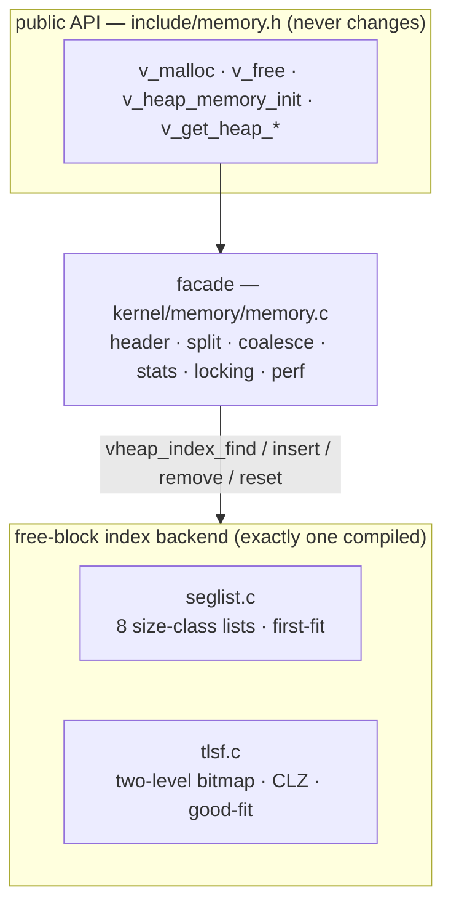

An allocator advertises its average. The average is also, for a real-time
kernel, the least interesting thing about it.

In an [earlier post](/engineering/benchmarking-vaios-against-freertos-zephyr/) I
measured VaiOS's heap against FreeRTOS and Zephyr and it came out well — flat
allocation cost across block sizes, and a fragmented-heap number that barely
moved while FreeRTOS's rose fourfold. Those are throughput and average figures,
and they are real. But they hide a worst case, and on a flight controller the
worst case is the whole story: a `v_malloc` that is usually 260 cycles but
occasionally walks a long list is not a 260-cycle allocator. It is a
long-list-walk allocator that is *usually* lucky.

Worse, that walk runs with interrupts disabled. So its worst case is not merely
slow allocation — it is **worst-case interrupt latency**, the one number a hard
real-time kernel is judged on. This post is about removing that tail: giving
VaiOS a second allocator that is O(1) in the worst case, making it swappable
with the old one, and — the part that took the most care — measuring the
difference *honestly*.

## 1. The tail, and where it lives

The VaiOS heap is a segregated-fit, boundary-tagged, coalescing allocator. Each
block carries a 16-byte header — magic, size, status, and a `prev` pointer to
the physically preceding block. That `prev` is the one genuinely elegant part:
it lets `free` coalesce backwards in O(1) instead of scanning the heap from the
head. Free blocks are filed on one of eight size-class lists (upper bounds 8,
16, 32, … 512, then a catch-all).

`free` is O(1). The tail is entirely in `malloc`:

```c
/* find a free block big enough — the search the whole design turns on */
for (Heap_Mem_Block *b = free_lists[c]; b; b = FREE_NODE(b)->next_free) {
  if (b->size >= size)          /* first-fit WITHIN the class */
    return b;
}
```

A size class spans a *range* — class 1 holds everything from 9 to 16 bytes — so
the head of the class is not guaranteed to fit a given request. You have to walk
until one does. On a fragmented heap that list can be long, and the catch-all
class holds every large free block there is. The walk length is bounded only by
the number of free blocks. That is the `O(n)` — and it sits inside
`ENTER_CRITICAL()`.

None of this is a bug. It is a perfectly good general-purpose allocator whose
one liability is exactly the property a control loop cares about most.

## 2. The fix already has a name: TLSF

The textbook answer for real-time allocation is TLSF — Two-Level Segregated
Fit. It is O(1) worst-case for *both* malloc and free, with a proven bound on
fragmentation, and it is, in effect, the VaiOS design with the walk removed.

The removal has two parts. First, size classes go two-level: a first level by
octave (`floor(log2 size)`) and a second level splitting each octave into 16
linear slots. Both indices are pure bit arithmetic — no search. A one-word
bitmap marks which octaves are non-empty; a per-octave bitmap marks which slots
are. Finding a fitting list is two find-first-set instructions, which fold to a
single-cycle `CLZ` on the Cortex-M4.

Second — and this is the trick that makes it O(1) with variable-size blocks —
`malloc` rounds the *request* **up** to a slot boundary before searching. That
guarantees every block in the chosen list satisfies the request, so you take the
list head with no per-block check and no walk. The small rounding is the only
cost, and it is what gives TLSF its bounded internal fragmentation (~6%).

The coalescing machinery — the boundary tag, the O(1) backward merge through
`prev` — carries over unchanged. Only the placement layer is different: a bitmap
lookup where the old heap had a list walk.

## 3. Making them swap

Two allocators that share a header, a splitter, and a coalescer should not be
two copies of the same file. So before writing a line of TLSF I split the heap
into a facade and a backend.



The facade owns everything identical across allocators: the block header, request
alignment, splitting on `malloc`, forward-and-backward coalescing on `free`, the
allocation counters, the watermark, the perf hooks, the critical sections. The
backend owns only the *free-block index* — a five-function contract:

```c
void            vheap_index_reset(void);
void            vheap_index_insert(Heap_Mem_Block *block);
void            vheap_index_remove(Heap_Mem_Block *block);
Heap_Mem_Block *vheap_index_find(uint32_t size);   /* returns; facade claims  */
const char     *vheap_index_name(void);
```

This is the split libc draws between `malloc` and `sbrk`, moved down to the
free-list. `seglist.c` and `tlsf.c` each implement those five functions; the one
not selected compiles to an empty translation unit, so there is never a symbol
clash even though both are always in the build. Selection is a single config
knob, `VAIOS_HEAP_ALGO`, resolvable from an app's config header or forced from
CMake with `-DVAIOS_HEAP_ALGO=TLSF`. The whole segregated allocator collapsed to
87 lines behind that contract; TLSF is 152. Nothing else in the kernel knows
which one it is talking to.

The host unit suite — 644 assertions including split, both coalesce directions,
exhaustion, and invalid-free — passes identically against either backend. That
is the contract doing its job: if the two are truly interchangeable, the same
tests must hold for both.

## 4. The measurement was lying

Now the actual question: does it help, and by how much? I wanted the cost of
every individual `malloc` and `free`, thousands of them, under a realistic
churn. On hardware that means the DWT cycle counter. I develop against QEMU,
though, so I ran the profiling example there first — and the numbers were
nonsense. Every allocation cost a tidy multiple of 100 cycles.

The reason was sitting in the port, and it was honest about itself:

```c
uint32_t v_port_hw_cycle_counter_read(void) {
  /* QEMU has no DWT we rely on here; monotonic stub keeps perf accounting
   * sane without a real cycle source. */
  static uint32_t fake;
  fake += 100;
  return fake;
}
```

QEMU's Cortex-M model has no DWT `CYCCNT`, so the port had stubbed it with a
counter that ticks 100 per read. Fine for keeping perf accounting from dividing
by zero; useless for measuring anything. My per-op "cycles" were just counting
how many times the code read the fake counter.

This is the trap the whole method exists to avoid, turned back on me: **a
counter you did not verify is not evidence, even when the counter is your own.**
I had a beautiful pipeline measuring a number that meant nothing.

## 5. A real clock, from semihosting

QEMU does keep time — it just doesn't expose it as a Cortex-M cycle register. It
exposes it through *semihosting*, the same channel VaiOS already uses for
console output under emulation. The `SYS_ELAPSED` call returns a 64-bit count of
elapsed ticks on the emulator's virtual clock: a real, monotonic,
high-resolution source.

So I mapped the DWT read onto it. On hardware, `v_perf_cycles()` still reads the
real counter; under QEMU it now reads virtual time:

```c
uint32_t v_port_hw_cycle_counter_read(void) {
#ifdef NAVHAL
  return hal_cycle_counter_get();      /* real DWT CYCCNT on the board */
#else
  return (uint32_t)sh_elapsed();       /* QEMU virtual clock via SYS_ELAPSED */
#endif
}
```

The stub is gone, and every perf path that reads cycles — not just my example —
gets a truthful number under emulation. That is a strictly better port.

It is not, however, a *clean* number. Without `-icount`, QEMU's virtual clock
tracks host wall-time, so each reading carries host jitter and the cost of the
semihosting trap itself. It is real time, but noisy time. Good enough to see
gross behaviour; too noisy to trust a 200-cycle difference. I could force
determinism with `-icount`, but that slowed a 1,200-operation run past any
patience I have.

## 6. The metric that needs no clock

The honest way out was to stop measuring time and start measuring *work*. The
tail I care about is the search — how many free blocks `malloc` has to inspect.
That is a deterministic integer, identical on QEMU, on hardware, on the host,
independent of any clock.

So the backend now reports it. `seglist.c` counts the blocks its walk touches;
`tlsf.c` reports 1 for a direct hit, 2 when it climbs one octave — constant by
construction:

```c
/* seglist: probes = length of the first-fit walk (grows with fragmentation) */
for (Heap_Mem_Block *b = free_lists[c]; b; b = FREE_NODE(b)->next_free) {
  probes++;
  if (b->size >= size) { vheap_find_probes = probes; return b; }
}
```

```c
/* tlsf: one bitmap hit, or one octave climb. never a walk. */
vheap_find_probes = climbed ? 2 : 1;
```

`probes` is the O(n)-versus-O(1) question asked directly, in units that can't
lie because there's no timing in them at all. The cycles number stays in the log
too — real, for hardware runs — but `probes` is the one I trust under emulation.

## 7. The workload

The profiling example, `mem_stress`, drives the heap the way a long-running
system does: a bounded live-set of up to 48 allocations, churned under a
deterministic pseudo-random mix of sizes — mostly small, some medium, a few
large — with allocations and frees interleaved so the free lists fragment and
coalesce continuously. The PRNG is seeded identically for both backends, so each
sees the *exact same* 1,200 operations. Every op emits one CSV row over the
console:

```
@MS,<seq>,<A|F|O>,<size>,<cycles>,<probes>,<live>,<bytes_in_use>
```

A host script builds the example once per backend, runs each under QEMU, and
overlays the distributions. Same seed, same board model, same everything but the
allocator — so any difference belongs to the backend.

## 8. What the run shows

Identical workload confirmed on both sides: 617 allocations, 583 frees, zero
out-of-memory. Here is the search cost — the metric that doesn't lie:

| malloc search cost | Unit | SEGLIST | TLSF | Leader |
|--------------------|------|---------|------|--------|
| median | probes | 1 | 1 | tie |
| p99 | probes | 6 | **2** | TLSF |
| worst case | probes | 8 | **2** | TLSF |


That is the whole thesis in one figure. At the median the two are identical — on
a healthy heap the segregated walk finds its block on the first try, and there
is nothing to beat. The difference is entirely in the tail: **TLSF's search is
flat and bounded at 2, while segregated-fit stretches to 8** as the free lists
lengthen. In the CDF, TLSF is a vertical wall at 2; SEGLIST leans over into a
tail. That tail is the interrupt-latency risk, and TLSF simply does not have one
— by construction, not by luck.

### The cycle numbers, and the outliers hiding in them

Cycles are the metric everyone wants, so here they are — with a lesson about
reading a noisy plot attached. Charted raw, every malloc looks like this:


A handful of samples at the very start reach past a million and squash
everything else flat. Those are not allocator cost; they are **emulator
warm-up.** Without `-icount`, QEMU's virtual clock tracks host wall-time (§5),
and the first time a stretch of code runs, QEMU's just-in-time translator must
compile that ARM into host instructions — a one-time cost that lands inside the
measured window. **Operation 0 pays for the first-ever `v_malloc`, the first
block split, the first `SYS_ELAPSED` call, and the first log write, all at
once**: 1.3 million "cycles." The next few allocations catch each remaining code
path as it runs for the first time — a different split class, the watermark
branch — and spike once more; `free` shows the identical pattern the first time
it coalesces. Within about two dozen operations every hot path is translated and
cached, and the readings collapse to their real few-thousand baseline. It is the
emulator warming up, not the heap.

Remove those warm-up samples — the five malloc readings above 100,000 cycles,
one in the segregated run and four in TLSF — and the real picture appears:


| malloc cost | Unit | SEGLIST | TLSF |
|-------------|------|---------|------|
| median — ignores the outliers | cyc | 5,168 | **4,819** |
| mean — warm-up included | cyc | **9,314** | 12,009 |
| mean — warm-up removed | cyc | **8,412** | 8,896 |

The apparent TLSF regression was **entirely warm-up**. With the five first-touch
samples gone the two means sit within six percent of each other, and at the
median — which never cared about the outliers — TLSF is a hair faster. Under
emulation the honest reading is that the two allocators cost about the same per
call, and the probes figure is where the real difference lives. The cycle gap
that actually matters — the bitmap lookup versus the interrupts-off walk under
genuine fragmentation — is a question for the hardware counter, not the virtual
clock.

## 9. On the board: real cycles, and a counter that wasn't turned on

The virtual clock did its job, but *that's a question for the hardware counter*
was a promissory note. So I put it on the Nucleo-F401RE: same firmware, same
1,200-operation workload, both backends, now `v_perf_cycles()` reading the real
DWT `CYCCNT`.

The first capture came back with **every cycle reading zero.** The probe column
was perfect — the same 1-to-8 spread as emulation — so the firmware was running
fine; the counter just wasn't ticking. Peeking the silicon over SWD:

```
DEMCR    = 0x01000000   TRCENA set
DWT_CTRL = 0x40000000   NUMCOMP=4 … but CYCCNTENA (bit 0) is CLEAR
CYCCNT   = 0x00000000
```

`CYCCNTENA` off. And here I nearly talked myself into the wrong bug. I had
openocd set bit 0 itself, ran the core, and `CYCCNT` sprang to life — 17 million
cycles in 200 ms, exactly right for 84 MHz. *So the register works with a probe
attached but not standalone* — I was one sentence from writing "the DWT lives in
the debug power domain, which the ST-Link only powers while connected," a tidy
story that fit every symptom.

It was wrong, and the cheap check caught it: **was my own init ever called?** The
DWT is armed by `v_perf_init()` — but `v_perf_init()` is reached only through
`v_system_init()`, the full bring-up that also starts the heap and the scheduler.
And `mem_stress` never calls it. It runs in bare `main()`: `v_init()` for clocks
and console, then straight into the workload, no scheduler. So `v_perf_init()`
never ran and `CYCCNTENA` was never set. The cycles that appeared with openocd
weren't my firmware's doing at all — **openocd enables the DWT itself on
connect,** for its own use. The probe wasn't powering a domain; it was doing the
initialization my code had skipped.

The fix is one line — `v_perf_init()` after `v_init()` — and the counter runs
standalone, over the UART, no probe anywhere near it. That is the lesson the
whole post keeps circling, turned on me this time: a story that fits the symptom
is not the cause. The counter check cost thirty seconds; the power-domain theory
would have cost a `TIM2` rewrite for a bug that was one missing call.

Now the cycles are real — and, unlike QEMU, **no warm-up outlier at all.** The
first malloc on hardware is 428 cycles, clean; a real CPU doesn't translate its
own code the first time it runs it. Here is the run the virtual clock couldn't
give me:

| malloc cost | Unit | SEGLIST | TLSF | Leader |
|-------------|------|---------|------|--------|
| median | cyc | **415** | 422 | SEGLIST |
| p99 | cyc | 490 | **468** | TLSF |


And the mechanism, in silicon. Bin every malloc by how many probes its search
took and average the cycles: segregated-fit costs 356 cycles at one probe and
adds ~25 for each one after — 416, 439, 457, 471 — out to 530 at eight. TLSF
spends 350 cycles on its one-bitmap-hit case, 449 on the one-octave-climb case,
and **nothing beyond.** The whole argument, rendered in cycles: **the probe count
is a faithful proxy for cost, and TLSF bounds the probe count.** On the common
case segregated-fit is a hair cheaper — TLSF pays a small fixed toll for the
bitmap and the `CLZ` — but its cost climbs with fragmentation while TLSF's does
not, and its p99 already trails.

One honest wrinkle in the raw numbers: the single worst sample in each run is not
search cost at all. The 1 kHz SysTick occasionally fires inside a ~5 µs malloc
window and charges its ISR to that sample, so both backends throw a rare
~650–700-cycle speck (the far-right dots in the CDF). That is why the table reads
p99, and why the per-probe curve — averaged over hundreds of samples — is the
honest picture, not the max.

## 10. The gap the gentle diet hid

The worst case in §9 was eight probes, not eight hundred — because that workload
holds a **bounded 48-slot live-set**, so its free lists never grow pathologically
long. The gap between the allocators is a property of the fragmentation you feed
them, and I had fed them a gentle diet. So I wrote the un-gentle one.

`mem_frag` piles up *N* free blocks in a single size class — each a 72-byte
block, each fenced by an allocated 8-byte spacer so it cannot coalesce with its
neighbours — then times a `malloc(120)`. Every one of those 72-byte blocks is too
small to satisfy 120, so segregated-fit's first-fit walk must step past all *N*
before it reaches a class that fits; TLSF's second-level split maps 120 to a slot
the 72s were never in, so it never inspects a single one. Ramped from one block
to 256, on the board:

, TLSF a flat line at 2. Right: the same in real DWT cycles — segregated-fit climbs ~12 cycles per block to 3,483 at depth 252; TLSF holds 455, flat.")

That is the whole thesis with the polite framing removed. Segregated-fit's cost
is a straight line in the free-list depth — **255 probes and 3,483 cycles** at
depth 252, rising ~12 cycles per block with no ceiling but the heap itself. TLSF
is a horizontal line: **2 probes, 455 cycles, flat to the byte**, whether the
class holds one free block or two hundred and fifty-six. The §9 run showed the
*shape*; this one shows the magnitude that shape implies — the difference between
an allocation that always costs the same and one whose cost is hostage to how
fragmented the heap has become.

## 11. What's honest about this, and what isn't

A couple of caveats, stated plainly.

The cycle timing under QEMU is real but jittery — which is exactly why §9 took it
to the board. The probe metric sidesteps the emulator entirely, and the hardware
run confirms it reads true: probe count and real cycles rise together.

TLSF is also not free, and the cost is RAM. Sizing the two F401 images shows
almost exactly what the design predicts:

| footprint | SEGLIST | TLSF | Δ |
|-----------|---------|------|---|
| flash (`.text`) | 30,568 B | 30,552 B | **−16** |
| static RAM (`.bss`) | 1,920 B | 2,848 B | **+928** |
| — the allocator backend alone | 32 B | 956 B | **+924** |

The 924 bytes are TLSF's two-level control block — a 14×16 array of free-list
heads (896) plus the two bitmap levels (60) — against segregated-fit's 32 bytes
of flat heads. It is a fixed cost, independent of heap size, about 1% of the
F401's 96 KB. Flash, to my mild surprise, went the *other* way: the
bitmap-and-`CLZ` lookup is 18 bytes tighter than the size-class ladder and its
walk, so the whole image is a hair *smaller* in flash. You buy the bounded worst
case with a kilobyte of `.bss`, and essentially nothing else.

## 12. What's next

One thread stays open, and it is the one that matters most for flight: interrupt
latency. The segregated walk runs with interrupts off, so its worst case is a
lower bound on the jitter it injects — and §10 shows that worst case is unbounded
in the free-list depth. Measuring it properly means a GPIO toggled around the
critical section and caught on a scope, not inferred from a cycle count; that is
the next thing to put on the board.

Both allocators now ship in VaiOS, one config line apart: segregated fit when the
worst case isn't the thing you are flying on and every byte of RAM counts, TLSF
when a bounded allocation is worth a kilobyte of `.bss`. The nice part is that
after the facade split, choosing between them is exactly that — one line, and the
same 644 tests either way.
