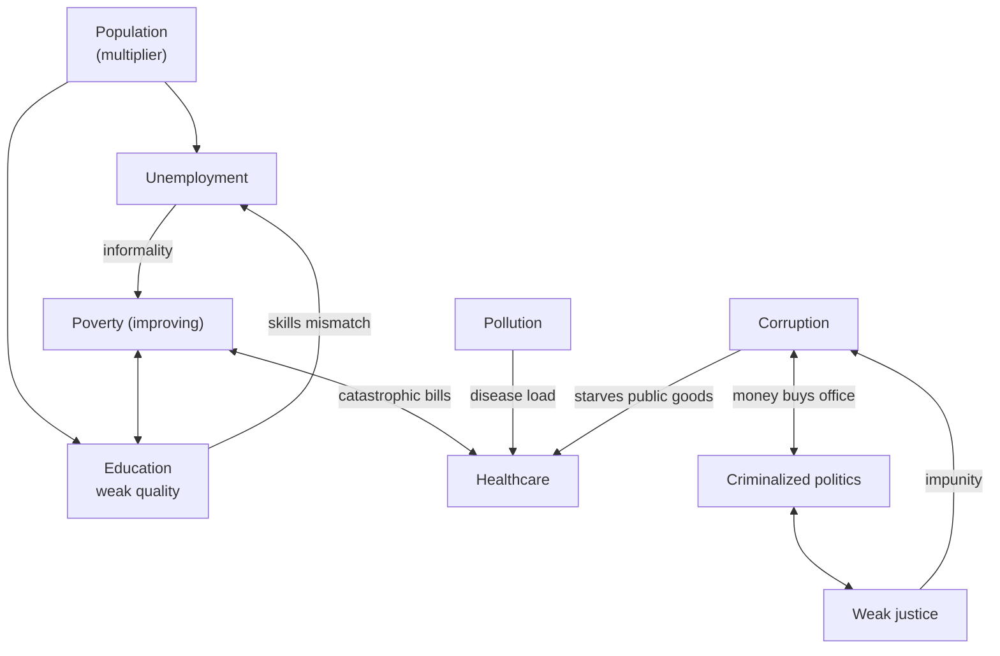

Ask anyone what is wrong with India and you will get a list. Corruption. Population. Unemployment. Poverty. Education. Healthcare. Politics. Everyone has the list; the items barely change from mouth to mouth.

I want to argue that it is not a list. It is a tree. The items are branches, and if you follow them down — patiently, refusing to stop at the first satisfying answer — they meet. There is one root, and almost nobody names it, because naming it costs something.

This essay is the descent. I will start where everyone starts, at the surface, with the numbers people actually quote. Then I will go down one layer at a time, and at each layer I will try to *kill* the explanation — because a cause that survives an honest attempt to disprove it is worth keeping, and one that doesn't was never the cause. By the end we will be standing at the bottom, and the bottom is not what the list-makers think.

---

## The surface: the numbers we recite

Let us be fair to the list first. The problems are real, and the data is not kind.

**The jobs paradox.** The official unemployment rate looks almost benign — 3.2% (MoSPI's Periodic Labour Force Survey, 2023–24). But that number is a decoy. Look at what happens when you sort the young by how much they studied.

Read that again. **The more you study, the less likely you are to have work.** India makes about five million graduates a year and finds jobs for fewer than three million of them. The degree, the thing families sacrifice everything for, is where the unemployment lives.

**Corruption that doesn't move.** India scores 38 out of 100 on Transparency International's 2024 Corruption Perceptions Index — rank 96 of 180, and effectively flat for over a decade. But the sharper picture is who ends up in Parliament.

Forty-six percent of the MPs elected in 2024 face criminal cases; thirty-one percent face *serious* ones — rape, murder, kidnapping. Ninety-three percent are crorepatis. A rich candidate's odds of winning were 19.6%; a non-rich one's, 0.7%. Money doesn't lobby the system here. Money *is* the system.

**The rest of the recited list, briefly, so the shape is clear:**

| Node | The number | Source |
|---|---|---|
| Healthcare | 43% of health spending is out-of-pocket; ~63M pushed into poverty by medical bills each year | NHA 2022–23; Oxfam 2021 |
| Education | Only 27% of Grade 3 children can read a Grade 2 text; 45% of 14–18-year-olds can do basic arithmetic | ASER 2024 / 2023 |
| Justice | 15 judges per million people (the benchmark is 50); ~50 million cases pending | India Justice Report 2022 |
| Pollution | PM2.5 at ten times the WHO limit; the world's most polluted capital; six of the ten worst cities | IQAir 2024 |
| Gender | 129th of 146 on the Global Gender Gap Index; 142nd on economic participation | WEF 2024 |
| Population | 1.44 billion — most populous on Earth since 2023 | UN WPP 2024 |

That is the surface. It is grim, and it is where almost every conversation stops.

But notice one node behaves differently.

 to 16.4% (2019–21) — roughly 414 million people out. Extreme poverty (the $3.00/day line) fell from 27.1% to 5.3%. Sources: UNDP/OPHI Global MPI 2025; World Bank India Poverty & Equity Brief 2025.")

Poverty is falling — hard. Around 414 million people left multidimensional poverty in fifteen years.

The obvious objection is that this is a mirage — incomes went up, but so did prices, so nothing really changed. It is worth checking directly, because if it fails, my "one node moved" claim collapses.

 rose about 1.9×. Strip the inflation out and real per-capita income still rose ~56% — roughly 4% a year. The poverty decline is real growth, not an accounting artifact. Sources: MoSPI National Accounts; RBI CPI series.")

It survives. Nominal per-capita income rose about 2.7×; prices roughly doubled; and even after inflation, real per-capita income still rose about 56% — around 4% a year. The fall is real. But note the catch, because it foreshadows everything below: the *average* rose while the *worker's wage did not*. Self-employed earnings were still only 85% of their pre-pandemic level two years on; real wages largely stagnated.

So the aggregate grew, but the growth pooled at the top — and by 2022–23 the concentration reached a historic extreme. On the World Inequality Lab's estimates, the top 10% now take **57.7%** of all national income and the top 1% take **22.6%** — the highest share in over a century, higher even than under British rule — while the bottom half of the country shares just **15%**.

. The median adult earns about ₹1 lakh a year; entering the top 0.1% takes ₹82 lakh — seventy-eight times the median. Right: the top 1%'s share of national income across a century — a 6.1% trough in 1982, then a steady climb after the 1991 liberalization to an all-time high of 22.6%. Source: Bharti, Chancel, Piketty & Somanchi (2024), World Inequality Lab.")

The median adult earns about ₹1 lakh a year; you need ₹82 lakh — seventy-eight times that — merely to *enter* the top 0.1%. The consumption Gini fell while this tower rose. Poverty improving and inequality worsening are not a contradiction. They are the same decade seen from two ends.

Hold on to the falling line anyway, because it is the exception that will explain the rule. Almost everything else is stuck; this one moved. Ask *why this one and not the others* and you have already started digging.

---

## First cut: they are not separate

The list treats these as independent problems, to be solved one department at a time. They are not independent. They are one system, and the arrows between them are the whole story.

Three things fall out once you draw it.

**There is an engine.** Corruption, criminalized politics, and weak justice are not three problems — they are one self-reinforcing loop. Money buys office; office extracts; courts too clogged to deter (fifty million pending cases) let it run; the extraction funds the next election. Round and round.

**There are traps.** Poverty and healthcare form one: the poor can't afford care, a health shock strikes, the bills push them under — sixty-three million a year. Poverty and education form another, one generation handing its poverty to the next.

**The engine starves everything else.** This is why India's public health spending is 1.48% of GDP — lowest among the BRICS. Not because the money doesn't exist. Because the engine eats it upstream.

So it is a system. But a map of arrows is still not a cause. Every node points at another node; nothing points at the *floor*. To find the floor we have to leave the map and ask a different question.

---

## Second cut: it is not the nodes, it is who fills them

Here is the question that leaves the map. Every one of those nodes is run by people. Corrupt officials, disengaged voters, apathetic citizens who won't clean their own street. So the honest question is not "what is wrong with the institutions" but **"what is wrong with the citizen the institutions are made of?"**

And the moment you ask it, someone reaches for the ugliest answer: maybe the people are just *like that*. Maybe it's in them.

It is not. And there is a clean proof.

**The diaspora.** Take the same Indian — same genes, same upbringing until adulthood — and drop them in Toronto, in London, in the Bay Area. They run companies. They win Nobels. They lead the institutions of other countries with exactly the civic competence they are accused of lacking at home. The DNA did not change on the flight. The *soil* did.

That single fact kills the biology theory outright. Whatever is wrong is not in the seed. It is in the ground the seed is planted in. Same DNA, different soil — and the plant grows completely differently.

So what is the soil doing to the seed?

---

## Naming the seed: agency

The usual next word is *critical thinking*. India doesn't teach it; the rote system rewards the memorized answer and punishes the question. That is true, and it is close, but it is not precise enough. Indians analyze brilliantly — you meet it in every engineering team on earth. The defect is not analysis.

The defect is **agency.**

Critical thinking is not just the ability to reason. It is *judgment that ends in a stance you are willing to own and act on.* And in India, the faculty of *taking a decision and standing behind it* is removed early, deliberately, and almost completely — then delegated upward to whoever sits above you.

Watch how total the delegation is, and notice it is *fractal* — the same move at every scale:

- What to study — a decision about your own mind — goes to your parents.
- Whom to marry, whom to love — goes to the family.
- The river, the road, the garbage outside your gate — goes to "the government."
- Corruption, injustice, the leaking system — goes to "what can one person even do."

Same abdication, different altitude. The Indian does not, as a rule, own the decision. He hands it up. And a mind that has never been allowed to own a *personal* stance has no muscle for a *civic* one. Thinking that never ends in a stance is inert. That is the seed: not stupidity — a trained-out capacity to decide.

Now: *why?* Why is the decision handed up? This is where the real digging starts, and where I have to start killing explanations.

---

## The elimination: two blades

From here I test each candidate cause with two blades. A cause survives only if it passes both.

- **Distinctiveness.** If other societies had the same thing and turned out *opposite*, it cannot explain the divergence.
- **Constancy.** If the cause varies or disappears but the suppression stays, it is not the cause.

**Caste.** The usual root. It fails the constancy test the instant you go indoors. Inside a single household everyone is the same caste — the variable is flat — and yet the child still has no choice and no standing against the family. Caste is a *horizontal* line, between families; the suppression is *vertical*, parent over child. Caste polices who you may marry. It has nothing to say about the dinner table where the crushing happens. Out.

**Economic dependence.** Surely the parent controls because the child depends — on the money, the roof, the arranged match. Real, and stronger in India than almost anywhere, since families fund children long into adulthood and the family business traps them further. But dependence ends when the paycheck starts. If leverage were the root, obedience would end with financial independence. It doesn't. The earning, wealthy, independent Indian *still* cannot marry against the family, still cannot take the stand. The suppression outlives the money. So dependence is an amplifier, not the root. Out.

**The extractive state.** Millennia of hierarchical, often brutal rule teaching deference to power. But this one fails distinctiveness cold. Europe's monarchies, Tsarist Russia, imperial Japan — often more centralized and more violent than India's distant empires — and they produced ferocious individual agency and opposition. A variable present in the societies that *diverged* cannot explain the divergence. Out.

**Religion.** It clears the first two hurdles — it is distinctive, and it is non-material, so it survives the money. But it fails constancy from a different direction: there is no single Indian religion. The "heart of India" is a mesh of local deities, values that don't agree across a district. It is not constant — yet the suppression is uniform everywhere, under every deity. A variable cause cannot produce a constant effect. And notice the mechanism is a fake: no parent actually quotes scripture while crushing a child's choice. The slogan is cited to outsiders, never used in the room. It is paint, not engine. Out.

Four candidates, four kills. And a pattern. Everything *material* or *external* washed out. What is left standing, after both blades, is the only thing that is neither: the **relational** — honor, deference, ownership of the person.

Two survivors.

---

## What survives: scarcity forged it, honor keeps it

The two that pass both blades do different jobs, at different stages, and together they answer *why India and not elsewhere.*

**Scarcity forged it.** Many people, thin margins, a world where one wrong move meant hunger. In that world the *tested* path beats the *novel* one, tradition is just accumulated risk data, and deviation is danger. So the group becomes the unit of survival, and the individual choice becomes a risk the group must bear — which buys the group the right to control the individual. This is why the family had to own marriage and career: your choices were the collective's economic life. Personal autonomy was not oppressed so much as *unaffordable.* Scarcity is the fire that cast the norm.

**Honor keeps it.** Once cast, the norm no longer needs the fire. It self-copies at the dinner table, generation to generation. The child is not a person but an extension of the parents' pride — a trophy to display, "my son the engineer." Obedience is made the highest virtue, above the child's own happiness or judgment. A child praised for obeying and punished for choosing, for eighteen years, never grows the muscle to decide. And crucially — this survives wealth, because honor is not material. The rich Indian family is often *more* controlling, not less. That is the proof that honor has gone autonomous of the scarcity that birthed it.

This resolves the paradox from the surface. Poverty is falling because poverty is *material* — money fixes it. The suppression is *not* material, so the same rising prosperity leaves it untouched. The one node that improved is the one made of the stuff that scarcity actually governs. Everything else is downstream of a norm that no longer answers to money.

The insurance policy became a cage. It kept people alive once. It outlived the danger, and now it just holds the door shut.

---

## The equilibrium: absorb, don't react

Trace the seed back up and you get the civic behavior that runs the whole map. If you are trained never to own a decision, your default toward any wrong — a bribe, a broken system, a leaked exam paper — is not to react. It is to absorb.

And here is the cruel part: absorbing is *rational.* Owning a stance means owning the blame. In a culture that does not forgive failure — "you chose that course," "you married against us," damned till they live — the math is cold:

- Obey and fail, and the blame is shared. *I only did what I was told.*
- Choose and fail, and the blame is yours alone. Forever.

So you delegate the decision *to escape the liability.* Silence is insurance. When a government-exam paper leaks, people do not storm the office; they wait for the next exam. Not because they aren't furious — because fighting costs months they cannot spare, and the one who fights alone is isolated and crushed, which teaches everyone watching that silence was correct. Everyone stays quiet, and the quiet keeps proving itself right.

It is not apathy. It is a trap, and everyone in it is behaving sensibly.

---

## The crack: how a trap like this breaks

If it is a trap, the useful question is not "how do we lecture people to care more." It is "how does a coordination trap actually break." And the answer is specific, so let me be specific — and honest, because India has tried and failed.

What holds the trap shut is not force. It is *belief* — everyone privately furious, everyone assuming they are the only one. The silence is made of mutual ignorance. So the crack is exactly one thing: **common knowledge.** Not "many are angry," but everyone knowing that everyone is angry. The instant private discontent becomes visible to all at once, the cost of voice collapses, and you get a sudden cascade. That is why real breaks are never gradual — 1989 Berlin, Tahrir, the Nirbhaya protests. One moment where the whole room sees the whole room.

Three things feed it: a spark everyone witnesses together; cheap coordination, which is the internet's real gift — it kills "you're alone" directly; and first-movers with enough *slack* to survive speaking while it is still dangerous.

But here is the rigor India forces. We *have* sparks. India Against Corruption in 2011 was enormous — and it vanished, co-opted, no lasting Lokpal. Why do our cascades flare and die? Because a spark makes a *moment*, not a *structure.* The crowd disperses, everyone goes back to assuming they are alone, and the trap reseals. **A spark opens the trap. Only an institution holds it open.**

And underneath even that is the deepest catch, where the two halves of this essay meet. Civic voice needs an agency muscle. That muscle was cut at the dinner table. A person who never owned a *personal* stance has nothing to sustain a *civic* one with. You cannot fix the public cage while the private one is intact — because the public one is locked from inside the private one.

So the real crack is upstream, and it is slow. The atomic unit is not a protest. It is **one person who owns a decision and survives the blame** — picks their path, their partner, their stand, and lives. Each one proves, to themselves and to everyone watching, that owning a choice is survivable. Multiply that, and you get a generation with the muscle to hold civic voice, and to raise children without the cage. One generation, not one election.

For the first time, the preconditions are assembling: the slack is rising (poverty is falling — the one good node is the one that funds first-movers), coordination is nearly free, and the diaspora is a live demonstration of the flipped equilibrium. The bottleneck is no longer material. It is the muscle. Which is exactly why the leverage point is the seed — how the next generation is raised to choose.

---

## Earned, not given

There is one more thing, and it is the reason I don't expect the crack to come cheap, or to want it to.

**Anything earned without a fight is held without value.** We defend what cost us; a right bled for is guarded to the death, a right handed over can be quietly taken back while nobody watches. India is the case study. Our Constitution is one of the finest documents ever written — rights, liberties, remedies. But it was *drafted*, not bled for. An elite assembly gifted a magnificent frame to a people who had not fought for *those* things. Compare the American civil-rights movement — earned at Selma, in blood — and you see the difference between a right that is owned and a right that is merely printed.

And this closes the whole argument. India *did* have a giant freedom struggle. So why no agency muscle? Because that fight was for **independence from Britain** — collective, national, against an external ruler — and it *demanded* obedience and sacrifice to the movement and its leaders. It was never the individual against his own society, for personal liberty. We fought to change the ruler, not to win freedom from authority itself. Independence was won; individual liberty was handed out afterward, on paper. That is why the document is gold and the ownership is thin. **We fought for the country. We never fought for the self.**

So the contention ahead, if it comes, is not the price of the prize. It *is* the prize being forged. Scarcity was the material fire that cast the old cage; struggle is the civic fire that would cast the new freedom. Nothing durable is cast cold. Hand a thinking, dissenting society to people frictionless, and they will lose it by Tuesday.

I keep returning to the road less taken. The first to walk it takes the thorns and the bushes. The next takes fewer. The one after that, fewer still — until the bushes subside and the path is worn as smooth as the road everyone already travels. The pioneer's suffering is not wasted; it is *amortized* over everyone who follows. The thorns are an entry fee, paid once, up front, by the first rank, for all who come after.

Which is the last, hardest turn of the whole thing. The person who reclaims agency *today*, in a society that has none, gets crushed — the one who fights the family or the system suffers first and visibly. The cure looks exactly like a new disease, early. That is why nobody names this root: it has no quick win, no one else to blame, and its first practitioners pay the most.

But it is the root. Every branch we followed — the jobless graduate, the criminal MP, the uncleaned river, the unquestioned bribe — runs down to the same place: a citizen taught, from the dinner table outward, to hand up the decision and absorb the result. Change how one child is raised to choose, and you have not added a capability. You have released one that was there in the DNA all along, waiting on better soil.

Do the work fully. Hold the results loosely. And take the road anyway.

---

*Sources for the figures and claims, in order of appearance: MoSPI Periodic Labour Force Survey 2023–24; ILO–IHD India Employment Report 2024; Azim Premji University State of Working India (2023, 2026); Transparency International Corruption Perceptions Index 2024; Association for Democratic Reforms, Lok Sabha 2024 analysis; National Health Accounts 2022–23 and Oxfam India Inequality Report 2021; ASER 2024 and 2023; India Justice Report 2022; IQAir World Air Quality Report 2024; WEF Global Gender Gap Report 2024; UNDP/OPHI Global MPI 2025; World Bank India Poverty & Equity Brief 2025; MoSPI National Accounts Statistics and RBI CPI series (per-capita income and inflation); Bharti, Chancel, Piketty & Somanchi (2024), World Inequality Lab (income disparity).*
